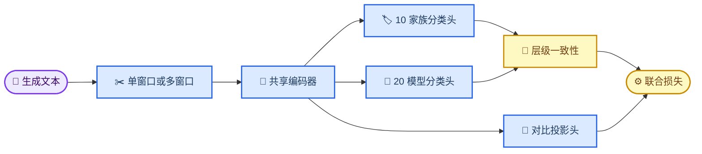

# 多模型生成文本溯源训练技术方案

_面向 10 个模型家族主分类与 20 个具体模型辅助分类的闭集溯源训练设计，版本 1.0，2026-07-30_

---

## 📋 文档状态

| 项目 | 内容 |
| --- | --- |
| **状态** | 方案已确认，待实施 |
| **当前数据版本** | V5 简化版 6K |
| **主要任务** | 10 个模型家族分类 |
| **辅助任务** | 20 个具体模型分类 |
| **计算资源** | 2 × NVIDIA RTX 4090D |
| **当前范围** | 闭集、被动、单篇文本溯源 |
| **暂不包含** | 开放集 Unknown、主动端点探针、线上部署 |

本文档规定训练目标、数据切分、候选基座、损失函数、实验顺序、消融设计、评价协议和阶段交付物。本文档只定义技术方案，不包含训练代码实现。

## 🎯 研究目标与边界

### 核心目标

给定一段由未知大语言模型生成的文本 \(x\)，系统同时输出：

\[
P(\text{family}\mid x), \qquad P(\text{model}\mid x)
\]

其中：

- `family` 是 OpenAI、Claude、Gemini、DeepSeek、Qwen、GLM、MiniMax、Kimi、Doubao、MiMo 共 10 个模型家族
- `model` 是 V5 数据配置中的 20 个具体模型
- 10 家族分类是最终模型选择和论文报告的主要任务
- 20 模型分类是辅助任务，用于研究同一家族内部的细粒度差异

### 研究问题

本阶段需要回答以下问题：

1. 字符、标点、格式和显式文体特征能否稳定区分模型家族
2. 多语言编码器全量微调是否优于字符 TF-IDF 基线
3. 字符级神经模型是否比语义型编码器更适合生成模型指纹
4. 家族与具体模型的层级联合训练能否提升主任务性能
5. 监督对比学习能否减少提示词主题泄漏
6. 多窗口输入能否改善长文本溯源
7. 字符、风格和神经模型融合是否具有互补增益
8. 模型在新提示词、跨语言和同家族新版本上的性能是否稳定

### 非目标

本阶段不追求：

- 人类文本与 AIGC 文本二分类
- 未知模型拒识和开放集识别
- 主动调用黑盒端点进行多轮指纹识别
- 使用 API 延迟、Token 用量、响应字段或错误类型参与分类
- 一开始就微调 7B 以上生成式大模型
- 为追求完整性穷举所有基座、损失和超参数组合

> 📌 **边界原则：** 分类器只以最终生成文本为输入。API 网关、请求模型名、Token 统计、`finish_reason` 和延迟只用于数据审计，不能成为预测特征。

## 🗃️ 数据与标签体系

### V5 数据规模

当前 V5 数据设计为：

\[
20\ \text{models}\times100\ \text{prompts}\times3\ \text{generations}
=6000\ \text{samples}
\]

每个具体模型计划生成 300 条文本。数据准备门槛为每个模型至少保留 285 条可用文本，即单模型可用率不低于 95%。详细采集规则见 [V5 数据采集手册](../../ATTRIBUTION_V5_SIMPLE_6K_RUNBOOK.md)。

三个生成重复由两种采样方式构成：

- `temperature=0.0`：1 次
- `temperature=0.8`：2 次

短文本和中等文本的生成预算为 4096 tokens，长文本为 8192 tokens。训练时不使用这些预算字段作为输入，但保留它们用于分组分析。

### 家族与具体模型映射

| 家族 | 快速或较轻版本 | 平衡或较强版本 |
| --- | --- | --- |
| **OpenAI** | `gpt-5` | `gpt-5.4` |
| **Claude** | `claude-haiku-4-5-20251001` | `claude-sonnet-4-6-20260217` |
| **Gemini** | `gemini-3-flash-preview` | `gemini-3.5-flash` |
| **DeepSeek** | `deepseek-v4-flash` | `deepseek-v4-pro` |
| **Qwen** | `qwen3.5-flash` | `qwen3.6-plus` |
| **GLM** | `glm-4` | `glm-5.1` |
| **MiniMax** | `minimax-m2.5` | `minimax-m2.7` |
| **Kimi** | `kimi-k2.5` | `kimi-k2.6` |
| **Doubao** | `doubao-seed-2-0-lite-260215` | `doubao-seed-2-1-pro-260628` |
| **MiMo** | `mimo-v2-pro` | `mimo-v2.5` |

该映射以项目内的 [`zhizengzeng_model_catalog.v5.json`](../../../configs/text_attribution/zhizengzeng_model_catalog.v5.json) 为唯一标签来源。数据记录中的显示名称不能覆盖配置中的家族映射。

### 可训练样本规则

样本进入训练集前必须满足：

- 文本非空
- `finish_reason` 表示正常结束
- 不属于内容过滤结果
- 不存在路由错配
- 语言与提示词要求一致
- 必要标签和提示词元数据完整
- 不与同标签、同提示词、同采样设置的已有文本完全重复

截断、内容过滤、重复和路由异常样本保留在原始数据中，但不进入主训练视图。清洗后类别不平衡时，以具体模型为单位进行采样平衡，不通过复制测试样本补齐数量。

## 🏗️ 总体训练架构


总体策略不是一次训练大量模型，而是按照“低成本基线—基座筛选—算法增强—受控消融—最终融合”逐级晋级。每一阶段只保留有验证集证据的方案。

## 🧭 候选技术路线

### 路线一：字符与显式风格基线

字符 n-gram 对分词方式不敏感，能够捕获标点、空白、常用短语和局部结构。此前 780 条干净样本的分组 OOF 实验中，字符 TF-IDF + Logistic Regression 的 Macro-F1 为 0.3263，高于词/字符 SVM 的 0.2692 和冻结 E5 线性探针的 0.1378。完整结果见 [先导基线报告](../../../outputs/attribution/zhizengzeng-local-pilot-v1-baselines/report.md)。

保留四个传统实验：

| 编号 | 输入表示 | 分类器 | 目的 |
| --- | --- | --- | --- |
| **B0** | 字符 n-gram TF-IDF | Logistic Regression | 主基线 |
| **B1** | 显式风格特征 | Logistic Regression | 检验可解释风格信号 |
| **B2** | 字符 TF-IDF + 风格特征 | Logistic Regression | 检验特征互补性 |
| **B3** | 词/字符 TF-IDF | Linear SVM | 保留旧基线对照 |

显式风格特征按以下类别组织：

- 字符组成：中文、拉丁字母、数字、符号和空白比例
- 标点风格：中英文逗号、句号、冒号、分号、引号、括号和破折号频率
- 句段结构：句长、段长、方差、段落数、空行数和换行密度
- 格式习惯：Markdown 标题、列表、编号、加粗、代码块和缩进比例
- 词汇习惯：词汇丰富度、功能词频率、重复短语和重复 n-gram 比例
- 首尾模式：开头承接语、结尾总结语和固定模板
- 长度属性：字符数、词数和句子数，仅作为可消融特征使用

### 路线二：预训练编码器全量微调

第一轮只比较三种具有不同归纳偏置的基座：

| 编号 | 基座 | 输入单位 | 第一轮定位 |
| --- | --- | --- | --- |
| **N0** | `FacebookAI/xlm-roberta-base` | SentencePiece 子词 | 多语言标准基线 |
| **N1** | `microsoft/mdeberta-v3-base` | SentencePiece 子词 | 不同预训练结构对照 |
| **N2** | `google/canine-c` | Unicode 字符 | 字符级神经指纹模型 |

XLM-R Base 是 12 层、768 隐藏维度的多语言编码器，最大位置长度为 514。[^1] mDeBERTa-v3-base 同样采用 12 层和 768 隐藏维度，并使用多语言 CC100 数据进行预训练。[^2] CANINE 不依赖 WordPiece 或 SentencePiece，直接以 Unicode 字符为输入，并在 104 种语言数据上预训练，更符合字符级模型指纹的研究假设。[^3]

三个基座第一轮均采用全量微调，不使用 LoRA。原因是其规模可在单张 4090D 上训练，全量微调能够直接比较表示能力，避免把“基座差异”和“参数高效微调差异”混在同一轮实验中。

### 路线三：层级多任务与监督对比学习

路线三只使用路线二中验证集表现最好的基座。它不是第四个独立基座，而是对获胜编码器的算法增强。

核心增强包括：

1. 10 家族与 20 模型双分类头
2. 家族和具体模型预测的一致性约束
3. 同模型跨提示词的监督对比学习
4. 同提示词跨模型的困难负样本采样
5. 首部、中央和尾部多窗口编码
6. 神经、字符和显式风格概率融合

监督对比学习通过拉近同标签样本、推远异标签样本学习判别表示。[^4] 当前数据对每个提示词收集所有模型的回答，天然适合构造“内容相近、来源不同”的困难负样本。

### 可选路线：Qwen LoRA 对照

`Qwen/Qwen3-1.7B-Base` 可在主路线完成后作为生成式骨干对照。Qwen3-1.7B 具有 17 亿参数并支持 100 多种语言和方言。[^5] 对该规模模型优先使用 LoRA 序列分类，而不是全量微调。

该路线不是主流程的前置条件。FDLLM 使用 Qwen2.5-7B、LoRA 和 9 万条覆盖 20 个模型的样本，说明其结果同时依赖较大的分类骨干与远大于当前 V5 的数据规模。[^6] 当前 6K 数据应先验证更轻量的字符和编码器方案，再决定是否投入 Qwen 路线。

ByT5 和 XLM-R Large 暂不进入第一轮。ByT5 直接处理 UTF-8 字节，适合后续字节级补充实验，但其序列更长、训练成本更高。[^7]

## 🧠 层级模型与训练目标

### 双头分类结构



对于文本 \(x\)，共享编码器产生表示：

\[
h=f_\theta(x)
\]

两个分类头分别输出：

\[
p_f=\operatorname{softmax}(W_fh+b_f)
\]

\[
p_m=\operatorname{softmax}(W_mh+b_m)
\]

### 联合损失

基础双头损失为：

\[
\mathcal{L}_{\mathrm{base}}
=
\mathcal{L}_{\mathrm{family}}
+\alpha\mathcal{L}_{\mathrm{model}}
\]

层级一致性将 20 模型概率按所属家族求和：

\[
\tilde{p}_f(k)
=
\sum_{m:\operatorname{family}(m)=k}p_m(m)
\]

\[
\mathcal{L}_{\mathrm{consistency}}
=
D_{\mathrm{KL}}(p_f\parallel\tilde{p}_f)
\]

加入监督对比学习后的完整目标为：

\[
\mathcal{L}
=
\mathcal{L}_{\mathrm{family}}
+\alpha\mathcal{L}_{\mathrm{model}}
+\beta\mathcal{L}_{\mathrm{consistency}}
+\lambda\mathcal{L}_{\mathrm{supcon}}
\]

初始权重建议：

| 参数 | 初值 | 解释 |
| --- | ---: | --- |
| \(\alpha\) | 0.7 | 具体模型辅助任务权重 |
| \(\beta\) | 0.1 | 层级一致性权重 |
| \(\lambda\) | 0.1 | 监督对比损失权重 |
| \(\tau\) | 0.07 | 对比学习温度 |

这些值只作为第一轮默认值。正式结论通过 `0` 与默认值对照判断模块是否有效，不进行大规模网格搜索。

### 训练批次构造

普通随机批次可能缺少有效正样本和困难负样本。对比学习阶段采用结构化批次：

- 正样本：同一个具体模型、不同语义提示词组的文本
- 普通负样本：不同家族的文本
- 困难负样本：不同模型回答同一语义提示词
- 超困难负样本：同一家族不同具体模型回答同一语义提示词

该设计迫使表示削弱主题内容，保留模型生成习惯。对比学习只在基础双头模型稳定后启用，不能与基座筛选同时引入。

### 层级推理

家族任务直接使用 \(p_f\)。具体模型任务使用软层级融合：

\[
P(m\mid x)
\propto
p_m(m)^\gamma
\cdot
p_f(\operatorname{family}(m))^{1-\gamma}
\]

默认 \(\gamma=0.7\)，并在验证集上固定。禁止先硬判定家族再只在该家族内部分类，因为家族头一次错误会让具体模型结果无法恢复。

## ✂️ 数据切分与防泄漏协议

### 固定分组切分

主实验使用一次生成、永久冻结的 `train`、`validation` 和 `test` 划分。建议比例为 70%/15%/15%，划分单位不是单条文本，而是 `semantic_prompt_group`。

必须同时进入同一集合的记录包括：

- 同一提示词下所有模型的回答
- 同一提示词的三次重复生成
- 中英文语义配对提示词
- 仅采样温度不同但语义内容相同的文本

因此，模型永远不能在训练集中见到测试提示词的其他模型回答。

### 划分产物

切分阶段必须冻结并保存：

| 文件 | 内容 |
| --- | --- |
| `split_manifest.json` | 数据版本、随机种子、语义组到集合的映射 |
| `label_map.json` | 10 家族、20 模型及父子关系 |
| `train.jsonl` | 训练请求键与必要元数据 |
| `validation.jsonl` | 验证请求键与必要元数据 |
| `test.jsonl` | 冻结测试请求键与必要元数据 |
| `dataset_audit.json` | 清洗、排除、类别和子组统计 |

数据文件可以引用原始记录的 `request_key`，不需要复制或修改原始 JSONL。所有模型共享同一份划分清单。

### 模型选择纪律

- 训练集用于拟合模型参数
- 验证集用于早停、基座筛选、损失权重和融合权重
- 测试集只在方案冻结后评估
- 任何查看测试集混淆矩阵后做出的修改，都必须在新的独立测试集上验证
- 传统模型使用相同的固定测试集，并额外提供分组 OOF 结果

## 📏 文本长度与多窗口策略

### 第一轮输入

| 基座 | 第一轮最大长度 | 说明 |
| --- | ---: | --- |
| **XLM-R Base** | 512 tokens | 单窗口基座筛选 |
| **mDeBERTa-v3 Base** | 512 tokens | 单窗口基座筛选 |
| **CANINE-C** | 1024 characters | 字符级筛选起点 |

第一轮统一从文本开头截取，目的是以最低成本比较基座。该结果不能作为最终长文本结论。

### 多窗口增强

只对最佳编码器增加首部、中央和尾部三个不重叠窗口：

\[
h=
\operatorname{Pool}
\left(
h_{\mathrm{first}},
h_{\mathrm{middle}},
h_{\mathrm{last}}
\right)
\]

初始使用均值池化；只有均值池化有明确增益时，才考虑注意力池化。短文本不重复填充三个相同窗口，而是只池化实际存在的唯一窗口。

需要比较：

- 前 512 tokens
- 首部、中央、尾部三窗口
- 统一 256、512 和 1024 字符的传统模型视图

## 🧪 实验顺序与消融矩阵

### 阶段一：传统强基线

依次运行 `B0`、`B1`、`B2` 和 `B3`。此阶段确定：

- 字符 n-gram 在 V5 上的真实上限
- 显式风格特征是否独立有效
- 长度和格式是否形成明显捷径

### 阶段二：神经基座筛选

`N0`、`N1` 和 `N2` 首先使用单一随机种子 `42` 和相同双头交叉熵训练。根据验证集家族 Macro-F1 选出前两名，再分别使用 `42`、`52`、`62` 三个随机种子完整训练。

基座筛选阶段禁止加入：

- 监督对比损失
- 多窗口
- 神经与字符融合
- 提示词对抗训练
- 大规模超参数搜索

### 阶段三：最佳基座增强

| 编号 | 模型变化 | 被检验因素 |
| --- | --- | --- |
| **A0** | 单独 10 家族分类头 | 单任务基准 |
| **A1** | 10/20 双分类头 | 辅助任务价值 |
| **A2** | A1 + 层级一致性 | 标签层级价值 |
| **A3** | A2 + 监督对比学习 | 内容不变指纹 |
| **A4** | A3 + 多窗口 | 长文本信息 |
| **A5** | A4 + 概率级融合 | 多视图互补性 |

每次实验只增加一个因素。若某一步在三个随机种子上没有稳定提升，后续模型不默认保留该模块。

### 阶段四：必要鲁棒性实验

| 消融 | 设置 | 目的 |
| --- | --- | --- |
| **数据规模** | 10%、25%、50%、100% | 绘制学习曲线 |
| **字符长度** | 256、512、1024 | 测量文本长度贡献 |
| **Markdown** | 原始、删除 Markdown | 检查格式捷径 |
| **标点** | 原始、删除标点 | 检查标点指纹 |
| **空白** | 原始、统一空白 | 检查段落与换行指纹 |
| **语言** | 中→中、英→英、中→英、英→中 | 测量跨语言泛化 |
| **版本留出** | 快版本训练、强版本测试并反向 | 测量家族泛化 |
| **窗口** | 单窗口、三窗口 | 测量长文本增益 |

版本留出实验只报告 10 家族分类。被留出的具体模型是训练阶段未见类别，不能把 20 模型闭集分类结果作为有效指标。

### 阶段五：可选大模型对照

只有在主路线稳定后才训练 Qwen3-1.7B LoRA。它与最佳编码器使用同一划分、同一文本窗口和同一评价指标，避免因数据协议不同产生不可比较结果。

## ⚙️ 默认训练配置

### XLM-R 与 mDeBERTa

| 参数 | 默认值 |
| --- | ---: |
| `learning_rate` | `2e-5` |
| 分类头学习率 | `1e-4` |
| `weight_decay` | `0.01` |
| `epochs` | `5–8` |
| 单卡批大小 | `16` |
| 梯度累积 | `2` |
| `warmup_ratio` | `0.1` |
| `label_smoothing` | `0.05` |
| 精度 | BF16 |
| 早停依据 | 验证集家族 Macro-F1 |
| 早停耐心 | 2 个评估周期 |

### CANINE

| 参数 | 默认值 |
| --- | ---: |
| `learning_rate` | `2e-5` |
| 第一轮最大长度 | `1024` characters |
| 单卡批大小 | `8` |
| 梯度累积 | `2–4` |
| 精度 | BF16 |
| 其他设置 | 与编码器一致 |

### 类别平衡

V5 设计上按具体模型平衡，因此第一轮不使用 Focal Loss 或类别权重。若清洗后最大类与最小类样本数之比超过 1.10，优先采用按具体模型均衡的 batch sampler；只有采样仍不能解决时，才加入轻量类别权重。

## 📊 评价协议

### 主指标

最终模型的第一排序指标是：

\[
\text{Family Macro-F1}
\]

Macro-F1 对每个家族赋予相同权重，可以避免总体准确率掩盖 GLM、MiMo 或 MiniMax 等困难类别。

### 完整指标

| 层级 | 指标 |
| --- | --- |
| **10 家族** | Macro-F1、Accuracy、Weighted-F1、每类 P/R/F1 |
| **20 模型** | Macro-F1、Accuracy、Top-3 Accuracy、每类 P/R/F1 |
| **校准** | ECE、Brier Score、NLL |
| **稳定性** | 3 个随机种子的均值与标准差 |
| **置信区间** | 按语义提示词组 Bootstrap 的 95% CI |
| **效率** | 参数量、峰值显存、训练时长、单篇推理时延 |

每次实验必须输出：

- 总体指标 JSON
- 家族与具体模型分类报告
- 两级归一化混淆矩阵
- 每条测试样本的预测 JSONL
- 按语言、目标长度、任务类型和采样温度划分的子组指标
- 训练曲线、验证曲线和运行配置快照

### 模型晋级规则

1. 首先比较验证集家族 Macro-F1
2. 差距小于 0.01 时，比较家族最差类别 F1
3. 仍接近时，比较 20 模型 Macro-F1
4. 仍无明显差异时，选择参数更少、速度更快的模型
5. 最终结论以三个随机种子的均值、标准差和组级置信区间为准

如果神经模型不能稳定超过字符基线，不强行选择神经模型；字符模型或融合模型可以成为最终方案。

## 🔗 最终融合策略

融合阶段使用验证集上的概率级加权：

\[
P_{\mathrm{final}}
=w_1P_{\mathrm{neural}}
+w_2P_{\mathrm{char}}
+w_3P_{\mathrm{style}}
\]

其中：

- \(P_{\mathrm{neural}}\) 来自最佳层级编码器
- \(P_{\mathrm{char}}\) 来自字符 TF-IDF + Logistic Regression
- \(P_{\mathrm{style}}\) 来自显式风格分类器
- \(w_1+w_2+w_3=1\)

融合权重只在验证集拟合。为避免复杂堆叠造成过拟合，第一轮使用非负线性权重，不使用深层元分类器。

融合实验必须与单个最佳模型同时报告，不能只展示融合后的最高分。

## 🖥️ 双 4090D 资源安排

中型编码器首轮训练采用“一张卡一个实验”：

- GPU 0：XLM-R Base
- GPU 1：mDeBERTa-v3 Base
- 任一实验结束后运行 CANINE-C

相对于把一个 270M 级模型拆成双卡 DDP，并行运行两个独立实验能更快完成基座筛选。三随机种子复现阶段同样分配到两张卡独立执行。

仅在以下情况启用双卡 DDP 或模型并行：

- 单卡无法容纳计划的多窗口批次
- 后续训练 XLM-R Large
- 后续训练更大 Qwen 对照
- 单模型训练时间成为实验瓶颈

每个新基座正式运行前先执行固定步数的显存和吞吐基准，训练文档不预先承诺具体耗时。

## 🚦 阶段门槛与交付物

### 数据冻结门槛

- 每个具体模型可用率至少 95%
- 无训练集与测试集语义提示词泄漏
- 训练、验证和测试中 20 个模型均有样本
- 清洗规则、排除原因和标签映射可复现
- 原始 JSONL 保持不可变

### 基线完成门槛

- `B0–B3` 使用同一划分运行完成
- 生成家族和具体模型两级结果
- 完成长度、Markdown、标点和空白初步审计
- 确认结果不依赖 API 元数据

### 神经筛选门槛

- `N0–N2` 使用相同配置完成单种子筛选
- 前两名完成三种子复现
- 模型选择只依据验证集
- 测试集在方案冻结前不参与调参

### 最终模型门槛

- `A0–A5` 的每次增益都有独立对照
- 完成跨语言、版本留出、数据规模和格式消融
- 输出最终模型、预处理配置、标签映射和推理契约
- 保存完整运行配置与可复现随机种子
- 最终测试结果包含均值、方差、置信区间和效率指标

## ⚠️ 主要风险与应对

| 风险 | 表现 | 应对 |
| --- | --- | --- |
| **提示词泄漏** | 测试分数虚高 | 按语义提示词组冻结切分 |
| **格式捷径** | 模型只识别 Markdown | 删除格式与显式消融 |
| **长度捷径** | 长文本类别表现异常高 | 固定长度实验与长度归一化 |
| **语言捷径** | 只会同语言分类 | 中英互测和配对分组 |
| **版本记忆** | 新版本家族分类下降 | 快/强版本互相留出 |
| **类别缺失** | 少数模型召回率低 | 具体模型均衡采样 |
| **过度复杂** | 模块多但增益不稳定 | 每次只增加一个组件 |
| **测试集污染** | 多次查看后继续调参 | 冻结测试集和实验登记 |
| **大模型过拟合** | 训练高分、提示词外下降 | 编码器优先，Qwen 后置 |
| **网关指纹** | 分类器识别中转站 | 文本单输入、未来增加跨网关测试 |

## 🗂️ 后续实现边界

后续代码应建立独立的训练模块，不改造旧二分类 `scripts/train_text.py`。建议的职责边界为：

```text
research/text_attribution/
├── training_data.py        # 清洗视图、标签映射和数据集对象
├── split_manifest.py       # 语义组切分与泄漏检查
├── style_features.py       # 显式风格特征
├── hierarchical_model.py   # 共享编码器与双分类头
├── attribution_losses.py   # 一致性与监督对比损失
├── attribution_trainer.py  # 统一训练和早停
├── attribution_metrics.py  # 两级指标、校准与子组统计
└── attribution_reporting.py# JSON、Markdown和图表输出
```

训练脚本、实验配置和测试分别放在：

```text
scripts/train_text_attribution.py
configs/text_attribution/training/
tests/test_text_attribution_training_*.py
```

现有先导基线的数据清洗、分组折叠、预测记录和报告逻辑可提取复用，但不能继续把训练实现写入旧的试验脚本中。

## 🔮 后续扩展

当前闭集主线完成后，再按研究需要增加：

1. 未知模型拒识与开放集校准
2. 新模型增量注册
3. 跨网关与跨时间测试
4. 人工润色、翻译、摘要和改写鲁棒性
5. 多篇文本聚合的端点级溯源
6. 主动探针选择与黑盒端点指纹

这些扩展使用当前编码器和评估框架，但不应提前增加到第一版训练代码。

## 🔗 参考资料

[^1]: Meta AI. (2019). “Unsupervised Cross-lingual Representation Learning at Scale” and `xlm-roberta-base` configuration. _Hugging Face_. https://huggingface.co/FacebookAI/xlm-roberta-base/blob/main/config.json

[^2]: Microsoft. (2021). “mDeBERTa-v3-base.” _Hugging Face_. https://huggingface.co/microsoft/mdeberta-v3-base

[^3]: Clark, J. H., Garrette, D., Turc, I., & Wieting, J. (2021). “CANINE: Pre-training an Efficient Tokenization-Free Encoder for Language Representation.” _Transactions of the Association for Computational Linguistics_. https://huggingface.co/google/canine-c

[^4]: Khosla, P., et al. (2020). “Supervised Contrastive Learning.” _Advances in Neural Information Processing Systems_. https://arxiv.org/abs/2004.11362

[^5]: Qwen Team. (2025). “Qwen3-1.7B.” _Hugging Face_. https://huggingface.co/Qwen/Qwen3-1.7B

[^6]: Fu, Z., et al. (2025). “FDLLM: A Text Fingerprint Detection Method for LLMs in Multi-Language, Multi-Domain Black-Box Environments.” _arXiv_. https://arxiv.org/abs/2501.16029

[^7]: Xue, L., et al. (2021). “ByT5: Towards a Token-Free Future with Pre-trained Byte-to-Byte Models.” _Transactions of the Association for Computational Linguistics_. https://huggingface.co/google/byt5-small

---

_最后更新：2026-07-30 · 当前版本只定义技术方案，代码实施需另行启动。_
