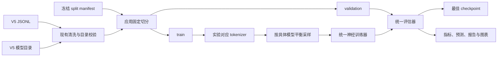

# 家族溯源 Phase2 神经基座筛选技术规格

_版本 1.0，2026-07-31_

## 文档状态

| 项目 | 内容 |
| --- | --- |
| 状态 | 已确认，进入实施 |
| 上游阶段 | Phase1 B0–B3 传统基线 |
| 当前数据 | V5，5686 条干净样本 |
| 固定切分 | train 3981 / validation 912 / test 793 |
| 正式标签 | 10 个模型家族 |
| 诊断标签 | 20 个具体模型 ID |
| 计算资源 | 2 × NVIDIA RTX 4090D |
| 本规格范围 | N0/N1/N2 单任务神经基座筛选 |

本文档是
[`2026-07-30-hierarchical-llm-attribution-training-design.md`](2026-07-30-hierarchical-llm-attribution-training-design.md)
中“阶段二：神经基座筛选”的实施级规格。层级辅助头、监督对比学习、多窗口、
神经融合、条件级联和 LoRA 不属于本轮范围。

## 目标与成功条件

本阶段构建一个统一、可恢复、可复现的神经文本家族分类训练引擎，并在完全相同的
数据切分与训练协议下比较三个基座：

| 实验 | Hugging Face 基座 | 输入上限 | 研究目的 |
| --- | --- | ---: | --- |
| N0 | `FacebookAI/xlm-roberta-base` | 512 tokens | 多语言标准基线 |
| N1 | `microsoft/mdeberta-v3-base` | 512 tokens | 多语言结构对照 |
| N2 | `google/canine-c` | 1024 characters | Unicode 字符级指纹模型 |

本阶段成功需要同时满足：

1. 三个实验共用现有清洗逻辑、标签目录和冻结 split manifest。
2. 默认运行只训练 train、评估 validation，不读取 test 文本。
3. 正式输出始终是 10 家族概率；具体模型仅用于采样和诊断。
4. 每个实验都可保存、重新加载并继续训练。
5. 输出与 Phase1 一致的总体、逐家族、逐版本、校准和子组指标。
6. 本地测试不需要访问网络或下载真实基座。
7. 服务器支持 dry-run、两步 smoke、完整训练和 checkpoint 恢复。
8. N0/N1/N2 首轮只使用 seed 42；根据 validation 选前两名后再运行
   seed 42、52、62。

## 明确不做的内容

本轮不实现：

- 20 模型版本分类作为正式任务；
- 家族与具体模型多任务损失；
- 层级一致性损失；
- 监督对比学习；
- 首中尾多窗口；
- 字符基线与神经模型融合；
- 测试集上的模型选择；
- LoRA 或生成式大模型分类；
- 开放集 Unknown 或拒识策略。

这些内容必须等基座筛选完成后，在独立的 A0–A4 增强规格中实施。

## 总体架构



Phase2 不复制 Phase1 的数据清洗、切分和报告实现。新增代码只负责神经配置、
tokenization、采样、训练生命周期和实验选型。

## 组件边界

### `neural_config.py`

负责读取和严格校验版本化 JSON 配置：

- 配置 schema 版本；
- N0/N1/N2 实验 ID；
- 模型路径、最大长度和批大小；
- 学习率、训练轮数、warmup、weight decay；
- 梯度累积、BF16、label smoothing；
- 早停、日志、保存和随机种子；
- 相对模型目录的解析。

配置中出现未知字段、错误类型、负数批大小或未知实验时必须立即失败。

### `neural_data.py`

负责把 `AttributionSample` 转为神经训练视图：

- 文本是模型唯一输入；
- 标签按照冻结的 `family_labels` 映射为整数；
- `model_id`、`request_key` 和子组字段保留为元数据；
- tokenizer 只在取样时执行，不把整套 tokenized 数据永久复制到仓库；
- 训练采样权重按具体模型训练样本数的倒数计算；
- validation 使用顺序采样，不做重采样；
- smoke 子集按家族和具体模型确定性抽样。

训练采样权重为：

\[
w_i = \frac{1}{n_{\operatorname{model}(i)}}
\]

归一化只影响数值尺度，不改变相对采样概率。这样 MiniMax、DeepSeek 等缺失较多的
具体模型不会在训练中被系统性忽略。

### `neural_training.py`

负责统一训练生命周期：

- 使用 `AutoTokenizer` 和 `AutoModelForSequenceClassification`；
- 使用 Hugging Face `Trainer` 及自定义模型平衡 dataloader；
- 单 GPU 训练，一个进程只占用一个指定 GPU；
- validation Macro-F1 作为最佳模型指标；
- `load_best_model_at_end=True`；
- EarlyStopping patience 为 2；
- checkpoint 保留最近两个；
- 支持 `resume_from_checkpoint`；
- 训练完成后保存标准 `save_pretrained` 模型与 tokenizer；
- 将 logits 稳定转换为固定家族顺序的 softmax 概率。

训练过程不得把 `model_id`、提示词、温度、长度目标、延迟或 token 统计传给模型。

### `neural_selection.py`

读取多个实验输出目录的 validation 指标，不加载模型参数。排序规则为：

1. validation Macro-F1 降序；
2. 最差家族 F1 降序；
3. validation NLL 升序；
4. 实验 ID 字典序。

它只负责生成筛选摘要，不评估 test。

### CLI

`scripts/run_family_attribution_neural.py` 是单实验入口。它负责：

1. 解析配置和 CLI 覆盖项；
2. 加载数据、目录和冻结切分；
3. 在 dry-run 中只输出解析结果；
4. 在 smoke 中构造小而覆盖所有家族的训练/验证子集；
5. 调用训练引擎；
6. 用现有指标与报告模块写出产物；
7. 通过临时目录完成原子输出替换。

`scripts/select_family_attribution_neural.py` 汇总 N0/N1/N2 的 validation 结果。

## 数据纪律

### 固定输入

Phase2 必须复用：

- 原始数据：
  `data/attribution/raw/zhizengzeng-attribution-server-6k-v5.jsonl`
- 模型目录：
  `configs/text_attribution/zhizengzeng_model_catalog.v5.json`
- 冻结切分：
  `data/attribution/splits/family-attribution-v5-seed42.json`

数据指纹不匹配时立即停止，不允许自动重建切分。

### Test 访问规则

默认 CLI 不提供隐式 test 评估。首轮 N0/N1/N2 和三随机种子比较都只写 validation。

如果后续需要评估冻结的神经胜出模型，必须使用独立显式参数
`--evaluate-test`，并在 `run_config.json` 中记录。因为 Phase1 test 已经被查看，
任何受现有 test 诊断影响的新算法结论都应在新的外部或时间切分数据上再次验证。

### Smoke 数据

`--smoke-test` 仅验证端到端工程链路：

- 每个具体模型最多 2 条训练样本；
- 每个家族至少 1 条 validation 样本；
- `max_steps=2`；
- 关闭早停；
- 不参与模型比较；
- 输出配置必须标记 `smoke_test=true`。

## 训练协议

### N0 与 N1

| 参数 | 值 |
| --- | ---: |
| learning rate | `2e-5` |
| epochs | `6` |
| per-device batch size | `16` |
| gradient accumulation | `2` |
| weight decay | `0.01` |
| warmup ratio | `0.1` |
| label smoothing | `0.05` |
| precision | BF16 |
| early stopping patience | `2` |
| best metric | validation Macro-F1 |

### N2

| 参数 | 值 |
| --- | ---: |
| learning rate | `2e-5` |
| epochs | `6` |
| per-device batch size | `8` |
| gradient accumulation | `4` |
| max length | `1024` |
| 其他参数 | 与 N0/N1 相同 |

如果运行设备不支持 BF16，正式运行必须明确传入 `--no-bf16`；代码不能静默切换精度。

## 双 GPU 调度

每个基座在单张 4090D 上全量微调，不启用 DDP。服务器脚本采用两个独立进程：

```text
GPU 0: N0
GPU 1: N1
等待 N0 或 N1 完成
GPU 0: N2
```

这样避免小数据集下 DDP 通信开销，也让三个实验的日志、checkpoint 和失败恢复彼此
隔离。GPU 分配通过 `CUDA_VISIBLE_DEVICES` 完成；CLI 内统一使用 `cuda:0`。

## 输出契约

每个完整实验输出：

```text
outputs/attribution/family-phase2/N0-seed42/
├── model/
├── tokenizer/
├── checkpoints/
├── run_config.json
├── dataset_audit.json
├── metrics.json
├── predictions.jsonl
├── trainer_history.json
├── report.md
├── overall_metrics.png
├── confusion_matrices.png
├── per_model_diagnostics.png
├── calibration.png
└── subgroup_metrics.png
```

`run_config.json` 至少记录：

- 数据路径和数据指纹；
- split manifest 路径和分配；
- 实验 ID、基座与模型 revision；
- label map；
- seed 和全部训练超参数；
- tokenizer 最大长度；
- smoke/test 标志；
- 是否从 checkpoint 恢复；
- transformers、torch 和 Python 版本。

`predictions.jsonl` 沿用 Phase1 记录契约，每条保存固定顺序的 10 家族概率及真实
`model_id`，不得保存 logits 代替概率。

## 错误处理与可恢复性

- 配置、目录、切分或标签不一致：训练前失败。
- CUDA OOM：保留 checkpoint 和日志，返回非零状态，不自动改变批大小。
- 模型下载失败：保留 Hugging Face 缓存，不生成成功输出目录。
- 训练中断：允许从明确的 checkpoint 路径继续。
- 正式输出目录已存在：默认拒绝覆盖；需要新的目录或显式安全覆盖策略。
- 最终报告写入失败：临时目录保留为失败证据，不替换正式输出目录。

## 测试策略

本地测试不访问 Hugging Face 网络。端到端测试在临时目录创建：

- 一个微型本地 BERT tokenizer；
- 一个随机初始化的微型序列分类模型；
- 覆盖 10 家族和多个语义组的合成 JSONL；
- 一个冻结 split manifest。

测试分为：

1. 配置严格校验；
2. 标签映射与模型平衡权重；
3. smoke 子集的确定性和覆盖性；
4. logits 到固定顺序概率；
5. dry-run 不创建输出；
6. 微型模型两步训练并生成可重载模型；
7. 默认不出现 test 指标；
8. checkpoint 恢复参数传递；
9. N0/N1/N2 validation 选型；
10. Phase1 全部回归测试。

## 实验顺序

1. 本地运行单元测试和微型模型端到端测试。
2. 服务器运行 N0 dry-run。
3. 服务器运行 N0 两步 smoke。
4. 两张 GPU 并行运行 N0 seed42 与 N1 seed42。
5. 运行 N2 seed42。
6. 汇总 validation 并选择前两名。
7. 前两名分别运行 seed42、52、62。
8. 报告均值、标准差、最差家族 F1 和逐版本诊断。
9. 冻结神经基座选择。
10. 另行设计 A0–A4 增强阶段。

## 验收标准

代码阶段完成的必要条件：

- 新增测试全部通过；
- Phase1 回归测试无退化；
- dry-run 不下载模型、不创建输出；
- 本地微型模型训练能够保存并重新加载；
- smoke 模式明确标记且不能被选型脚本当作正式结果；
- validation 指标与预测概率使用固定家族顺序；
- 默认输出不包含 test；
- 服务器脚本可以独立指定两张 GPU；
- README/运行手册列出需要上传的文件和准确命令。

模型阶段完成的必要条件：

- N0/N1/N2 seed42 均有完整 validation 产物；
- 前两名三随机种子结果完整；
- 至少一个神经实验在 validation Macro-F1 上超过 Phase1 B3 的 `0.5818`，
  或者明确记录神经模型未超过传统基线；
- 不因单次随机种子结果直接进入增强阶段。
