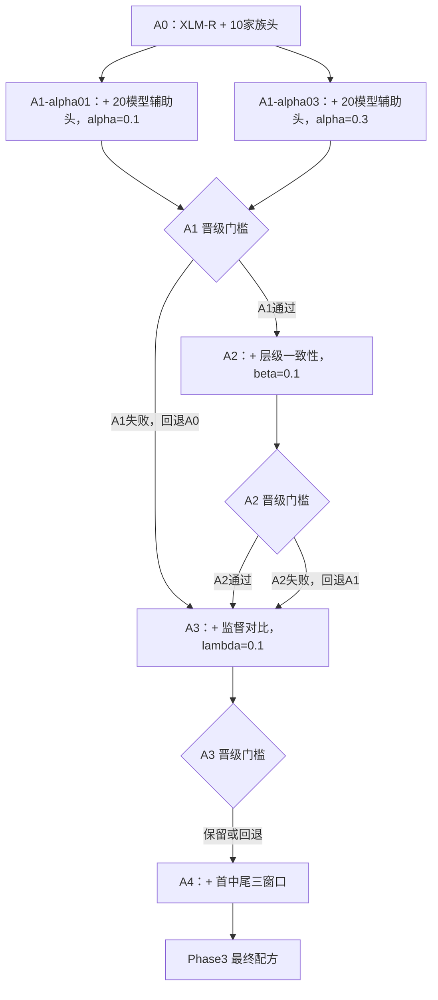

# 家族溯源 Phase3 增强训练技术规格

_版本 1.0，2026-08-02_

## 文档状态

| 项目 | 内容 |
| --- | --- |
| 状态 | 设计已确认，等待实施计划 |
| 上游阶段 | Phase2 N0/N1/N2 神经基座筛选 |
| 获胜基座 | `FacebookAI/xlm-roberta-base` |
| Phase2 证据 | N0 8-seed validation Macro-F1 `0.5575 ± 0.0184` |
| 固定数据 | V5，5686 条干净样本 |
| 固定切分 | train 3981 / validation 912 / test 793 |
| 标签 | 10 个模型家族；20 个具体模型仅用于辅助监督与诊断 |
| 计算资源 | 2 × NVIDIA RTX 4090D |
| 本规格范围 | A0–A4、双向版本留出、validation-only 晋级与服务器交付 |

本文档把
[`2026-07-30-hierarchical-llm-attribution-training-design.md`](2026-07-30-hierarchical-llm-attribution-training-design.md)
中的“阶段三：最佳基座增强”细化为实施级规格。Phase4 概率融合、条件级联、
开放集 Unknown、LoRA 和最终 test 不属于本阶段。

## 背景与基座冻结结论

Phase2 对 N0 XLM-R、N1 mDeBERTa 和 N2 CANINE 进行了统一 validation-only
筛选。N0 与 N1 进一步使用 seed 12、22、32、42、52、62、72、82 比较。

| 指标 | N0 XLM-R | N1 mDeBERTa |
| --- | ---: | ---: |
| Accuracy | `0.5772 ± 0.0137` | `0.5118 ± 0.0450` |
| Macro-F1 | `0.5575 ± 0.0184` | `0.4920 ± 0.0532` |
| NLL | `1.2299` | `1.4149` |
| ECE | `0.0536` | `0.0775` |
| Brier | `0.5559` | `0.6202` |

相同 seed 的配对差异 N0−N1 为 `+0.0655`，8 个 seed 中 N0 获胜 7 次。
因此 Phase3 固定使用 `FacebookAI/xlm-roberta-base`，不得在 A0–A4 中重新选择
基座或混入新的预训练模型。

N0 的主要家族短板是 MiMo、GLM 和 DeepSeek。Phase3 的增强不能只提升总体均值：
任何候选都必须同时报告最差家族、MiMo、GLM 和双向版本留出结果。

## 目标与成功条件

Phase3 的目标是回答以下四个受控问题：

1. 20 模型辅助监督能否提高 10 家族识别，同时保持未见版本泛化。
2. 家族概率与具体模型聚合概率的一致性约束是否提供额外增益。
3. 家族级监督对比学习能否削弱提示词主题和具体版本记忆。
4. 首部、中央、尾部三窗口是否改善长文本溯源。

本阶段成功需要：

1. A0–A4 共用 XLM-R、数据指纹、冻结 split、标签顺序和训练协议。
2. 每次实验只增加一个因素；未晋级模块不进入后续配方。
3. 每个候选同时完成闭集 validation 和两个版本留出方向。
4. 默认入口在接口层面不接受 test 评估参数。
5. 每次训练可保存、重新加载、恢复并验证配方哈希。
6. 每次选择产生逐项门槛结果，而不是只给出一个最高分。
7. 本地测试不访问网络或下载真实 XLM-R。
8. 服务器支持 dry-run、CPU smoke、GPU preflight、正式训练和 checkpoint 恢复。
9. 服务器交付包不包含数据、模型权重、输出或密钥。

## 明确不做的内容

Phase3 不实现：

- N1 或 N2 的进一步训练；
- 新基座、XLM-R Large、Qwen 或 LoRA；
- 字符/风格概率融合；
- 第二神经模型条件级联；
- test 评估；
- Unknown 拒识或开放集校准；
- 主动探针、网关元数据或延迟特征；
- 深层堆叠元分类器；
- 大规模超参数网格搜索。

## 实验图与回退语义



“当前最佳方案”由上一阶段的 `promoted_recipe.json` 明确给出。A2–A4 不从父
checkpoint 继续训练；每个候选都从同一个预训练 XLM-R 初始化，并根据完整解析配方
从头训练。这样候选与父方案的区别只有当前被检验因素，而不是额外训练轮数。

如果 A1 未晋级，A2 必须标记为 `skipped_by_gate`，A3 以 A0 为父配方。如果 A2、
A3 或 A4 未晋级，选择器保留其父配方，不把失败模块带入后续阶段。

## 深模块与接口

Phase3 新代码位于独立模块中，不改变 Phase2 N0–N2 的既有行为。调用方只依赖以下
三个主要接口：

```python
def resolve_phase3_recipe(
    stage: str,
    parent_decision: Path | None,
) -> ResolvedPhase3Recipe: ...


def train_phase3_experiment(
    request: Phase3TrainingRequest,
) -> Phase3TrainingResult: ...


def select_phase3_stage(
    request: Phase3SelectionRequest,
) -> Phase3StageDecision: ...
```

复杂度隐藏在这些接口之后。CLI 不负责构造损失、模型头、窗口或 batch；它只负责
解析参数、加载冻结数据、调用接口并原子发布产物。

### 文件职责

| 文件 | 职责 |
| --- | --- |
| `configs/text_attribution/training/family_phase3_enhancement.v1.json` | 阶段规则、固定权重、种子和晋级门槛 |
| `research/text_attribution/phase3_config.py` | 严格配置解析与不可变配方解析 |
| `research/text_attribution/phase3_data.py` | 模型标签、版本留出、多窗口视图和结构化 batch |
| `research/text_attribution/hierarchical_model.py` | XLM-R、家族头、模型头和投影头 |
| `research/text_attribution/attribution_losses.py` | 家族、模型、一致性和监督对比损失 |
| `research/text_attribution/phase3_training.py` | 训练生命周期、早停、恢复、预测和保存 |
| `research/text_attribution/phase3_selection.py` | 多 seed、多视图门槛与配方晋级 |
| `scripts/run_family_attribution_phase3.py` | 单个配方/seed/数据视图入口 |
| `scripts/select_family_attribution_phase3.py` | 阶段选择 CLI |
| `scripts/run_attribution_phase3.sh` | 双 GPU 分阶段调度 |
| `scripts/package_attribution_phase3_server.py` | 无密钥项目根叠加 ZIP |
| `docs/ATTRIBUTION_PHASE3_RUNBOOK.md` | 上传、运行、恢复、选择与下载手册 |

## 配置与解析配方

Phase3 配置使用严格 JSON schema version 1。未知字段、布尔值冒充整数、非有限浮点、
未知阶段、未知窗口模式或不一致权重必须立即失败。

配置包含：

- 固定基座 `FacebookAI/xlm-roberta-base`；
- 最大长度 512；
- A0–A3 batch 16、梯度累积 2；
- A4 batch 4、梯度累积 8；
- learning rate `2e-5`；
- epochs 6；
- weight decay `0.01`；
- warmup ratio `0.1`；
- label smoothing `0.05`；
- BF16；
- early stopping patience 2；
- A1 候选 alpha `0.1`、`0.3`；
- A2 beta `0.1`；
- A3 lambda `0.1`、temperature `0.07`；
- A3 projection dimension 256；
- 初筛种子 42、52、62；
- 最终补充种子 12、22、32、72、82；
- 所有晋级门槛。

解析后的 `ResolvedPhase3Recipe` 至少记录：

```text
stage_id
recipe_id
parent_recipe_id
backbone_model_id
max_length
auxiliary_weight
consistency_weight
contrastive_weight
contrastive_temperature
projection_dimension
window_mode
batch_size
gradient_accumulation_steps
gradient_checkpointing
全部公共训练超参数
```

解析配方以规范化 JSON 计算 SHA256。`run_config.json`、checkpoint 和选择输出都保存
该哈希。恢复时配方哈希、数据指纹、split 指纹、seed 和数据视图必须完全一致。

## 数据纪律与三种 validation 视图

Phase3 继续复用：

- V5 原始数据；
- V5 模型目录；
- `family-attribution-v5-seed42.json` 冻结 split；
- Phase2 清洗、标签和报告逻辑。

### 闭集视图 `closed`

训练使用原 train 的 20 个具体模型，评估使用原 validation 的 20 个具体模型。

### 版本留出 `fast-to-balanced`

训练只保留原 train 中 `variant_role=fast` 的 10 个模型；评估只保留原 validation 中
`variant_role=balanced` 的 10 个模型。

### 版本留出 `balanced-to-fast`

训练与评估角色反向。

角色只能来自 V5 catalog 的 `variant_role`。目录必须满足每个家族恰好有一个 `fast`
和一个 `balanced`，否则训练前失败。不得根据模型名称、大小或供应商推断角色。

三个视图都沿用原语义提示词组切分，不从 test 补样本。每个训练和验证视图必须覆盖
全部 10 家族；审计产物记录每家族、每模型和每角色的样本数。

Phase3 CLI 不提供 `--evaluate-test`。任何包含 test 请求键的输入视图都必须被拒绝。

## 模型结构

### 共享编码器

`HierarchicalAttributionModel` 使用 `AutoModel` 加载 XLM-R 编码器。单窗口取首 token
表示，多窗口先分别编码各窗口，再对有效窗口的首 token 表示求掩码均值。

家族分类头复现 XLM-R 序列分类头的结构：dropout、dense、tanh、dropout、输出投影。
因为 Phase3 使用自定义模型封装，A0 必须在 Phase3 引擎中重新运行，Phase2 的 N0
结果只作为外部一致性参照，不与 Phase3 候选直接混算。

### 家族头

家族头始终输出固定顺序的 10 家族 logits。正式推理和主指标只使用该输出。

### 具体模型辅助头

A1 及其晋级后代增加训练视图内固定顺序的具体模型 logits。闭集视图包含全部 20 个
具体模型，因此辅助头为 20 类；版本留出视图只包含 10 个训练可见模型，因此辅助头
为 10 类。验证中未见的具体模型不加入辅助头 label map，也不计算版本分类准确率。
这样层级聚合不会包含从未训练的随机类别。辅助头只参与训练与诊断；产品输出不承诺
具体版本识别。

### 对比投影头

A3 及其晋级后代增加 `768 → 256 → L2 normalize` 的投影。投影只用于监督对比损失，
家族分类仍使用投影前的共享表示。

### 保存与加载

模型保存：

- 编码器和自定义头权重；
- XLM-R 配置；
- Phase3 模型配置；
- family label map 和当前数据视图的 train-visible model label map；
- resolved recipe 和哈希；
- tokenizer。

加载器必须能在无训练数据的情况下重新加载并输出相同 logits。保存格式不得依赖
训练进程中的 Python 对象地址或临时目录。

## 联合损失

总损失为：

\[
\mathcal L =
\mathcal L_{family}
+ \alpha \mathcal L_{model}
+ \beta \mathcal L_{consistency}
+ \lambda \mathcal L_{supcon}
\]

### 家族损失

所有阶段使用带 `0.05` label smoothing 的 10 家族交叉熵。

### 模型辅助损失

A1 使用 train-visible 具体模型交叉熵：闭集为 20 类，版本留出为 10 类。alpha 只
允许 `0.1` 或 `0.3`。alpha 为 0 时不得创建或调用模型辅助头。

### 层级一致性

A2 将当前视图 train-visible 模型 softmax 概率按照 catalog 的模型→家族映射求和，
再计算：

\[
D_{KL}(p_{family}\parallel\tilde p_{family})
\]

计算必须使用数值稳定的 log 概率和 epsilon clamp。A1 未晋级时不得构造 A2 配方。

### 监督对比损失

A3 使用 family label 定义正负样本，temperature 固定 `0.07`：

- 正样本：同家族、不同语义提示词组；
- 强正样本：同家族、不同具体模型、不同语义提示词组；
- 困难负样本：同语义提示词组、不同家族；
- 普通负样本：不同家族、不同语义提示词组。

自配对从正样本掩码中排除。没有有效正样本的 anchor 不进入对比损失分母统计；如果
一个完整 batch 没有任何有效 anchor，训练立即失败而不是返回零损失。

训练历史逐步记录总损失和四项原始损失，便于识别某一辅助项数值失控。

## A3 结构化 batch

每个默认 batch 为 16 条：

- 确定性选择 8 个家族并轮换覆盖 10 家族；
- 选择两个不同语义提示词组；
- 每个家族在两个提示词组中各取一条；
- 闭集视图优先让同家族两条来自不同具体模型；
- 版本留出视图只有一个训练版本时允许同模型，但提示词组必须不同；
- 同提示词组内的其他家族自然形成困难负样本。

采样器以 seed 控制并可恢复。恢复 checkpoint 后的 batch 顺序必须与不中断运行一致。
训练前 dry-run 报告可构造 batch 数、家族覆盖、强正样本率和困难负样本率。

如果当前视图无法形成至少一个满足约束的 batch，A3 在训练前失败，不静默退回普通
WeightedRandomSampler。

## A4 三窗口

tokenizer 首先在不截断且不添加特殊 token 的情况下得到内容 token IDs。内容窗口的
可用长度由 tokenizer 的特殊 token 数量从 512 中扣除。

- 长度不超过一个内容窗口：只生成首部窗口；
- 超过一个窗口：生成首部、居中和尾部窗口；
- 窗口内容完全相同时去重；
- 每个窗口使用 tokenizer 官方方法添加特殊 token；
- 返回 `window_mask` 标识有效窗口。

模型把 batch 与窗口维度展平后共享编码，再按 `window_mask` 对首 token 表示求均值。
验证输出记录每条样本的有效窗口数，并报告短、中、长文本子组指标、吞吐和显存。

A4 初始 per-device batch 4、梯度累积 8，有效 batch 保持 32。正式运行前必须执行
10 optimizer-step GPU preflight。如果 A3 对比损失已晋级，显存不足时必须保留 batch 4
并显式启用、哈希绑定 gradient checkpointing；batch 2 无法同时提供正样本和困难负样本。
仅当 A3 未晋级、A4 不含对比损失时，才可显式选择 batch 2、累积 16 的预定义低显存
配置。代码不得静默降低 batch、长度、窗口数或精度。

## 训练生命周期

所有正式实验使用：

- BF16；
- validation Macro-F1 选择最佳 checkpoint；
- `load_best_model_at_end=True`；
- early stopping patience 2；
- checkpoint 保留最近两个；
- 单 GPU 单进程；
- seed 同时控制 Python、NumPy、PyTorch、sampler 和 Transformers；
- validation 顺序采样；
- 原子发布最终目录。

每个训练任务只处理一个 `recipe × seed × data_view`。输出目录已存在时失败。失败任务
保存在 `.failed-<uuid>` 证据目录并写 `FAILED.json`，不自动重试。

CPU smoke 每个模块只运行两个 optimizer step，关闭早停与 checkpoint 选择，不参与
任何晋级。A4 GPU preflight 只测链路、显存和吞吐，也不参与晋级。

## 阶段种子与计算控制

A0–A4 初筛固定使用 seed 42、52、62。每个候选需完成：

```text
3 seeds × 3 data views = 9 training runs
```

最终胜出配方与其直接父配方再补 seed 12、22、32、72、82，在相同三个数据视图形成
8-seed 最终比较。不得根据初筛结果选择对候选更有利的新 seed。

## 晋级规则

选择器只接受：

- `smoke_test=false`；
- `preflight=false`；
- `test_evaluated=false`；
- 完整的 3 seed × 3 view；
- 相同数据指纹、split、标签映射和父配方；
- 无 NaN、无缺失指标、无 validation 家族 support 为零。

相对于父配方，新候选必须同时满足：

1. 闭集平均 Macro-F1 增益至少 `0.01`；
2. 闭集 3 个 seed 中至少 2 个获胜；
3. 闭集平均最差家族 F1 不下降；
4. 闭集 MiMo 平均 F1 不下降；
5. 闭集 GLM 平均 F1 不下降；
6. 两个版本留出方向合并平均 Macro-F1 不下降；
7. 任一版本留出方向平均 Macro-F1 降幅不超过 `0.01`；
8. 没有任一家族在任一正式闭集 seed 中 F1 为零；
9. 训练和预测产物完整。

A1-alpha01 和 A1-alpha03 先分别与 A0 比较。若二者都通过，再按以下顺序选择：

1. 闭集平均 Macro-F1；
2. 双向版本留出平均 Macro-F1；
3. 闭集平均最差家族 F1；
4. NLL；
5. ECE；
6. alpha 更小者。

NLL、ECE、Brier、训练时间和推理成本是次级指标，不覆盖主晋级门槛。选择器输出每一
条门槛的输入值、差值、布尔结果、晋级或回退原因。

## 输出契约

### 单次训练目录

```text
<recipe>-seed<seed>-<view>/
├── COMPLETED.json
├── resolved_recipe.json
├── run_config.json
├── dataset_audit.json
├── metrics.json
├── predictions.jsonl
├── trainer_history.json
├── loss_components.json
├── report.md
├── overall_metrics.png
├── confusion_matrices.png
├── per_model_diagnostics.png
├── calibration.png
├── subgroup_metrics.png
├── model/
├── tokenizer/
└── checkpoints/
```

`predictions.jsonl` 的正式字段保存固定家族顺序的 10 家族概率。启用辅助头时允许在
明确标记的诊断字段保存当前视图 train-visible 模型概率：闭集为 20 类，版本留出为
10 类。未见模型不强行映射到辅助类别；不得用模型概率替代家族概率。

`run_config.json` 记录数据和 split 指纹、视图、配方与哈希、seed、完整超参数、
模型 revision、标签映射、环境版本、smoke/preflight 标志和恢复来源。

### 阶段选择目录

```text
selection-<stage>/
├── stage_decision.json
├── stage_decision.md
└── promoted_recipe.json
```

`stage_decision.json` 至少包含：

```text
parent_recipe
candidate_recipes
每个 seed/view 的原始指标
候选与父方案的配对差异
9 条门槛的输入值和布尔结果
promoted
promoted_recipe_id
fallback_recipe_id
selection_scope=validation_only
```

## CLI 与调度

### 单实验 CLI

`scripts/run_family_attribution_phase3.py` 支持：

```text
--config
--stage
--recipe
--parent-decision
--data-view closed|fast-to-balanced|balanced-to-fast
--input
--catalog
--split-manifest
--output-dir
--seed
--device cpu|cuda:0
--hf-cache
--no-bf16
--smoke-test
--gpu-preflight
--resume-from-checkpoint
--dry-run
```

参数采用三个互斥解析模式：

- canonical：`--stage A0|A1-alpha01|A1-alpha03`，不传 recipe 或父选择；
- promoted：`--stage A2|A3|A4 --parent-decision <path>`，由父选择解析新配方；
- replay/resume：`--recipe <resolved_recipe.json>`，不传 stage 或父选择。

CLI 必须拒绝混合模式或缺少父选择的 A2–A4。它不支持 `--evaluate-test`。

### 选择 CLI

`scripts/select_family_attribution_phase3.py` 接收父方案与候选的输出根目录，严格发现
所需 seed/view 目录，生成阶段选择产物。缺失或重复运行均失败。

### 双 GPU 调度

`scripts/run_attribution_phase3.sh` 每次只运行用户指定阶段。它根据 resolved recipe
和 seed/view 任务表，把独立任务分配到两张物理 GPU；任一任务失败时等待在途任务
安全结束，不启动新的任务，并返回非零状态。

调度脚本不自动跨越晋级门槛。用户必须先运行选择 CLI，下一阶段才读取
`promoted_recipe.json`。这避免失败候选被自动带入后续阶段。

## 错误处理与安全

训练前失败条件包括：

- 配置 schema、字段或类型错误；
- 基座不是固定 XLM-R；
- 数据、split 或 catalog 指纹不一致；
- catalog 版本角色不唯一；
- 任一数据视图缺少家族；
- 数据视图包含 test 请求键；
- 配方父关系或哈希不一致；
- checkpoint 与当前任务不一致；
- A3 无法构造结构化 batch；
- 输出目录已存在；
- 正式 GPU 训练请求 CPU；
- BF16 不支持但未显式 `--no-bf16`；
- 发现非有限 loss、logits 或概率。

模型输入只能包含 token IDs、attention mask、window mask 和训练标签。`request_key`、
`model_id`、prompt、semantic group、语言、长度、温度等元数据只供采样和评估使用，
不得作为编码器特征。

## 测试策略

本地测试使用微型本地 BERT、临时词表、记录型 tokenizer 和合成
`AttributionSample`，不访问网络。测试至少覆盖：

1. 严格配置、配方解析和哈希稳定性；
2. fast/balanced catalog 角色校验；
3. 三种数据视图的家族覆盖和 test 隔离；
4. A3 正样本、强正样本、困难负样本与确定性恢复；
5. A4 短文本去重、首中尾边界、特殊 token 与 window mask；
6. 家族、模型、KL 和 SupCon 损失的已知数值、有限梯度和禁用路径；
7. A0–A4 forward 输出形状与元数据隔离；
8. 自定义模型保存后 logits 一致；
9. 两步 smoke、正式 GPU 限制、失败目录和 checkpoint 配方校验；
10. 3 seed × 3 view 完整性和逐项晋级/回退；
11. CLI 无 test 参数且无法间接读取 test；
12. 服务器 ZIP 清单、哈希、路径、密钥和权重排除。

测试遵循 red-green-refactor，每个新行为必须先看到目标失败，再实现最小代码。

## 服务器交付

本地构建：

```text
dist/aigc-detector-attribution-phase3-server.zip
```

ZIP 是项目根目录叠加包，包含 Phase3 代码、复用的 Phase2 模块、配置、测试、规格、
计划、依赖清单和运行手册。它明确排除：

- V5 JSONL；
- split manifest；
- `.env` 和密钥；
- Hugging Face 缓存；
- 模型、tokenizer 和 checkpoint 权重；
- outputs 和 logs。

服务器已有 Phase2 项目、V5 数据、split 和 XLM-R 缓存时只需上传该 ZIP。运行手册
必须给出：

1. 本机构建与校验；
2. 上传和覆盖解压；
3. 环境与 GPU 检查；
4. dry-run；
5. A0–A4 CPU smoke；
6. A4 GPU preflight；
7. A0/A1 首轮调度；
8. 每阶段选择和下一阶段配方；
9. checkpoint 恢复；
10. 不含权重的结果打包下载命令。

## 完成门槛

Phase3 实现完成需要：

- 所有新增和相关回归测试通过；
- A0–A4 都能使用微型本地模型完成 smoke；
- 阶段选择器能在合成完整运行矩阵上晋级和回退；
- 包构建和包校验通过；
- ZIP 不含数据、密钥、输出或权重；
- 文档命令与 CLI `--help` 一致；
- Phase2 N0–N2 行为和既有测试不回归；
- 服务器叠加包和复制清单可直接交付。
